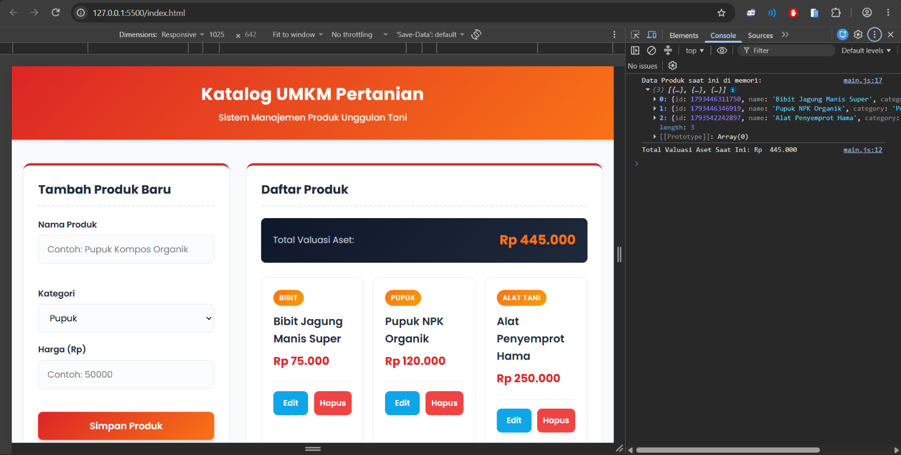

# Sistem Katalog Produk UMKM Pertanian 🌾

Proyek Ujian Tengah Semester (UTS) mata kuliah Dasar Pemrograman Frontend STIKOM PGRI Banyuwangi. Dibangun secara murni menggunakan Vanilla JS (ES6+), HTML5 Semantic, dan CSS Modern tanpa framework eksternal.

## 🌟 Fitur Utama

1. **Arsitektur Modular (ES Modules)**: Kode dipisah secara terstruktur menjadi `service.js`, `validator.js`, `ui-renderer.js`, dan `main.js`.
2. **Manipulasi Data Dinamis (CRUD)**: Mendukung penambahan, pembacaan, pembaruan (Edit), dan penghapusan produk secara langsung (*DOM Manipulation*).
3. **Data Agregasi HOF**: Menggunakan `Array.prototype.reduce()` untuk menghitung total valuasi aset secara *real-time*.
4. **Validasi Form Client-Side**: Mencegah input kosong atau harga tidak valid dengan pesan peringatan di bawah input (*Error State*).
5. **Interactive UI (Toast)**: Memberikan umpan balik visual (notifikasi melayang) saat aksi berhasil dilakukan.
6. **Mobile-First CSS**: Layout responsif dari layar *smartphone* hingga *desktop* layar lebar.

## 📁 Struktur Direktori

```text
katalog-umkm-pertanian/
├── index.html
├── README.md
└── assets/
    ├── css/
    │   └── style.css
    └── js/
        ├── module/
        │   ├── service.js
        │   ├── ui-renderer.js
        │   └── validator.js
        └── main.js
```

## 📸 Tangkapan layar

